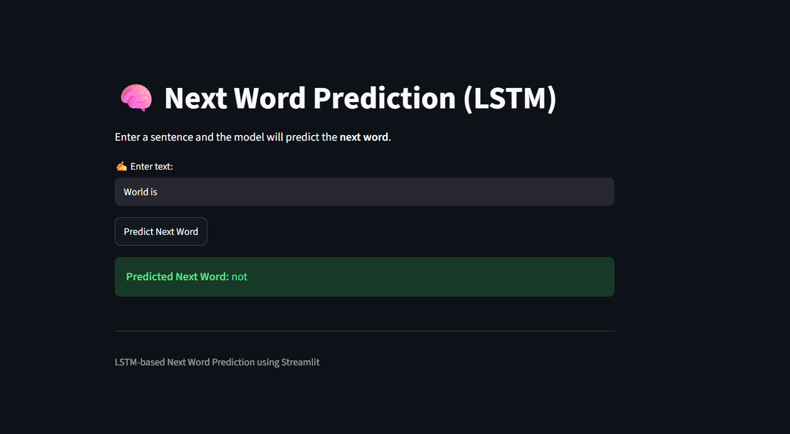

# 🧠 LSTM Next Word Prediction

A next-word prediction model built with an **LSTM** network in Keras/TensorFlow and served through an interactive **Streamlit** web app. Type the beginning of a sentence and the model predicts the most likely next word.

🔗 **Live Demo:** [Try the app here](https://next-word-pred-using-lstm.streamlit.app)

---

## 🖼️ Demo



*Streamlit UI: enter a sentence, click **Predict Next Word**, and see the prediction.*

---

## 📌 Overview

The model is trained on a dataset of ~3,000 famous quotes. Each quote is expanded into many prefix → next-word training pairs (e.g. `the` → `world`, `the world` → `as`, ...), giving ~85,000 training samples. An LSTM then learns to predict the next word from the preceding words.

## ✨ Features

- Text preprocessing (lowercasing, punctuation removal)
- Tokenization and sequence padding with Keras
- Baseline `SimpleRNN` vs. `LSTM` model comparison in the notebook
- Multi-word text generation (predict repeatedly to extend a sentence)
- Simple Streamlit UI for live predictions

## 🏗️ Model Architecture

| Layer | Details |
|-------|---------|
| Embedding | vocab size 10,000, embedding dim 50 |
| LSTM | 128 units |
| Dense | 10,000 units, softmax |

- **Loss:** categorical cross-entropy
- **Optimizer:** Adam
- **Batch size:** 128
- **Validation split:** 10%
- **Input length:** 745 tokens (left-padded)

## 📂 Project Structure

```
LSTM-next-word-prediction/
├── app.py                  # Streamlit web app
├── next_word_pred.ipynb    # Data prep, model training and experiments
├── lstm_model.h5           # Trained LSTM model
├── tokenizer.pkl           # Fitted Keras tokenizer
├── max_len.pkl             # Max sequence length used for padding
├── requirements.txt        # Python dependencies
├── assets/
│   └── screenshot.png      # UI screenshot used in this README
└── README.md
```

> **Note:** The training dataset (`qoute_dataset.csv`, columns: `quote`, `Author`) is not included in the repo. Add it next to the notebook if you want to retrain.

## 🚀 Getting Started

### 1. Clone the repository

```bash
git clone https://github.com/<your-username>/LSTM-next-word-prediction.git
cd LSTM-next-word-prediction
```

### 2. Create a virtual environment (recommended)

```bash
python -m venv venv
source venv/bin/activate      # On Windows: venv\Scripts\activate
```

### 3. Install dependencies

```bash
pip install -r requirements.txt
```

### 4. Run the app

```bash
streamlit run app.py
```

Then open the URL shown in your terminal (usually `http://localhost:8501`).

## 💡 Usage

1. Enter a few words in the text box, e.g. `the world as we`
2. Click **Predict Next Word**
3. The predicted word appears below

To retrain or experiment, open `next_word_pred.ipynb` in Jupyter or Google Colab and run the cells in order.

## 📊 Results & Limitations

- The LSTM reaches roughly **76% training accuracy**, but validation accuracy is only around **7%** (validation loss rises while training loss falls), which is a clear sign of **overfitting**. The small dataset (~3k quotes) and the very large 10,000-word output layer both contribute.
- Predictions work best on phrases similar to the training quotes and can drift into less coherent text when generating many words in a row.
- Words outside the tokenizer's vocabulary are ignored.

### Ideas for improvement

- Train on a larger corpus
- Add dropout / early stopping, or stacked / bidirectional LSTMs
- Use pre-trained embeddings (GloVe, Word2Vec)
- Show top-k predictions with probabilities instead of a single word
- Save the model in the native `.keras` format instead of legacy `.h5`

## 🛠️ Tech Stack

- Python
- TensorFlow / Keras
- NumPy, Pandas
- Streamlit

## 🤝 Contributing

Suggestions and pull requests are welcome. Feel free to open an issue to discuss changes.

## 📄 License

Distributed under the MIT License. Add a `LICENSE` file to the repo if you choose this license.

## 👤 Author

**Sneha**
Final-year B.Tech CSE (Data Science) student
